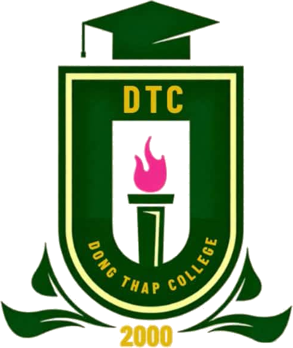

# 📅 Thời Khóa Biểu DTC - Trường Cao Đẳng Đồng Tháp

<p align="center">
  
</p>

<p align="center">
  <strong>Ứng dụng tra cứu thời khóa biểu sinh viên Trường Cao Đẳng Đồng Tháp (DTC)</strong><br>
  <em>Lưu hành miễn phí • Siêu tốc • Tiện lợi • Hỗ trợ xem ngoại tuyến khi mất mạng</em>
</p>

<p align="center">
  
  
  
  
</p>

---

## 👨‍💻 Thông Tin Tác Giả & Đơn Vị

* **Tác giả phát triển**: **Phan Nguyễn Hữu Nghĩa**
* **Lớp**: **CĐ DVTY K26B**
* **Đơn vị**: **Trường Cao Đẳng Đồng Tháp**
* **Thông điệp**: *Ứng dụng được phát triển phi lợi nhuận và lưu hành miễn phí, giúp các bạn sinh viên tra cứu thời khóa biểu một cách nhanh chóng, chính xác, tiện lợi mọi lúc mọi nơi kể cả khi không có kết nối mạng.*

---

## ✨ Tính Năng Nổi Bật

- 🔍 **Tìm kiếm lớp học toàn trường (Global Class Search)**:
  - Thanh tìm kiếm thông minh quét tức thì trên toàn bộ **776 lớp học** của trường.
  - Hiển thị đầy đủ **Tên lớp**, **Mã lớp** và **Badge Khoa trực thuộc**.
  - Tự động chuẩn hóa đúng Khoa khi chọn lớp, xóa bỏ khóa cũ để tránh lỗi không tương thích.
- 📌 **Lưu & Xem nhanh lớp gần đây (Recent Classes)**:
  - Tự động ghi nhớ các lớp đã tra cứu kèm mã Khoa.
  - Highlight viền nổi bật lớp đang xem, chuyển đổi qua lại giữa các lớp chỉ với **1 chạm**.
- 🛡️ **Bảo vệ phòng thủ 2 lớp (Defense-in-Depth)**:
  - Server & Client đồng bộ kiểm tra `classFacultyMap` (100% độ phủ 776/776 lớp).
  - Tự động sửa lỗi khi người dùng mang theo Khoa cũ sang lớp của Khoa khác, chống tải nhầm môn hoặc trả về bảng rỗng.
- 📆 **Chế độ xem linh hoạt**:
  - **Từng ngày (Daily)**: Hiển thị chi tiết từng tiết học, giảng viên, phòng học của ngày đã chọn.
  - **Toàn tuần (Weekly)**: Hiển thị tổng quan toàn cảnh lịch học từ Thứ 2 đến Chủ nhật.
- ⏳ **Điều hướng tuần mượt mà**:
  - Xem tuần trước, tuần sau, chọn nhanh bất kỳ tuần nào trong 25 tuần học kỳ.
  - Nút bấm **"Về tuần hiện tại"** hoạt động trơn tru ngay cả khi đang ngoại tuyến.
- 📶 **Hỗ trợ Ngoại tuyến 100% (Offline-First / PWA)**:
  - Tích hợp **Service Worker** và bộ nhớ đệm `localStorage`.
  - Mất mạng, hết 4G hay máy chủ cổng trường bảo trì vẫn mở app xem lịch học và danh sách lớp bình thường.
- ⚡ **Bộ nhớ đệm siêu tốc (In-Memory Server Cache)**:
  - Phản hồi dữ liệu trong **0.01 - 0.02 giây**, bảo vệ cổng đào tạo trường không bị nghẽn mạng khi sinh viên truy cập đông.
- 🌓 **Giao diện Hiện đại**:
  - Hỗ trợ đầy đủ chế độ **Sáng (Light Mode)** và **Tối (Dark Mode)** bảo vệ mắt.
- 🎁 **Tính năng ẩn (Easter Egg)**:
  - Chạm liên tục 10 lần vào biểu tượng đổi Sáng/Tối để mở thông tin phiên bản và tác giả.

---

## 📱 Các Phiên Bản Ứng Dụng

### 1. Dành cho Android (.apk)
* File cài đặt: `TKB_DTC.apk`
* Dung lượng: Siêu nhẹ chỉ **~1.75 MB** (khi cài vào máy chiếm ~6 - 8 MB).
* Cài đặt: Tải file `.apk` về điện thoại Android và mở cài đặt trực tiếp.

### 2. Dành cho iOS (iPhone / iPad)
* **Cách 1 (Khuyên dùng - PWA)**: Mở link trên Safari ➔ Bấm nút **Chia sẻ** (Share ⬆️) ➔ Chọn **"Thêm vào Màn hình chính"** (*Add to Home Screen*). Chạy toàn màn hình như ứng dụng gốc từ App Store, dùng vĩnh viễn không bị Apple giới hạn 7 ngày.
* **Cách 2 (File .ipa)**: Sử dụng file `TKB_DTC.ipa` cài qua 3uTools, Sideloadly hoặc TrollStore (hỗ trợ iOS 12.0+ trở lên).

### 3. Phiên bản Web (Online & PWA)
* Truy cập trực tiếp qua trình duyệt trên máy tính và điện thoại.
* Hỗ trợ cài đặt trực tiếp dạng Progressive Web App (PWA) chỉ với 1 click.

---

## 🚀 Hướng Dẫn Cài Đặt & Chạy Cục Bộ (Local)

### Yêu cầu:
* Python 3.8 trở lên

### Các bước thực hiện:
1. Tải hoặc clone mã nguồn:
   ```bash
   git clone https://github.com/<tai-khoan-cua-ban>/tkb-dtc.git
   cd tkb-dtc
   ```

2. Cài đặt các thư viện cần thiết:
   ```bash
   pip install -r requirements.txt
   ```

3. Khởi chạy máy chủ:
   ```bash
   python server.py
   ```

4. Mở trình duyệt và truy cập:
   ```
   http://localhost:5000
   ```

5. Chạy bộ kiểm thử tự động (Test Suite):
   ```bash
   python test_suite.py
   ```

---

## ☁️ Triển Khai Miễn Phí Lên Render.com

1. Đăng ký tài khoản tại [Render.com](https://render.com) (liên kết với GitHub).
2. Chọn **New +** ➔ **Web Service** ➔ Chọn kho GitHub `tkb-dtc`.
3. Cấu hình dịch vụ:
   - **Runtime**: `Python 3`
   - **Build Command**: `pip install -r requirements.txt`
   - **Start Command**: `python server.py`
   - **Plan**: `Free`
4. Bấm **Create Web Service** để hoàn tất và nhận đường link web chính thức.

---

## 📄 Giấy Phép (License)

Dự án được phân phối dưới giấy phép [MIT License](LICENSE).  
Mọi người có thể tự do tham khảo, học tập và sử dụng vì mục đích học tập phi thương mại.
